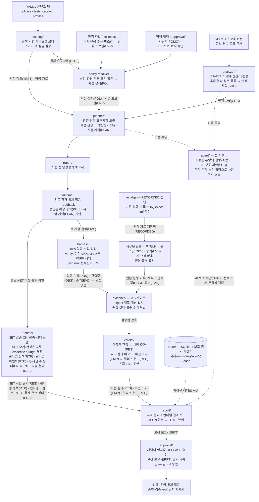
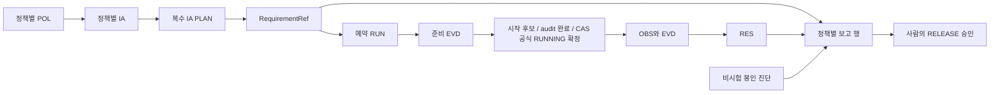

# A3. 아키텍처 설계서 v2.0

> v2.0 기준선 · 2026-10-02 · A14 D37~D39. 문서 검토 반영본이며 팀 소유자 승인·코드 시험·실측 완료를 뜻하지 않는다.

- **이 문서가 정하는 것:** 파이프라인 단계와 모듈 경계, 계획서 단계↔A1 S1~S8 대응, 모듈별 책임·데이터 흐름·배포 형태
- **다른 문서에서 가져오는 것:** 단계 책임·교환 객체·불변식(A1 v2.0), 정책 입력(A11 v2.0), 시험 판정(A7 v2.0, A5 v2.0), 런타임 설계(A6 v2.0), 도구 보안(A13 v2.0)

**소유:** T3 · **상태:** v2.0 문서 기준선(2026-10-02; 구현·실측 완료 아님) · **기준:** A1 v2.0

> 계획서 2.4.4의 파이프라인을 모듈 경계로 옮긴 것.
> 프로세스를 나누지 않는다. 단일 Python 패키지의 제어 계층에 CLI/API를 연결하고, 시험 Pod·센서는 별도 배치한다.

> **런타임 통제는 범위에 포함한다** (A14 D24). 계획서 8단계를 모두 쓰며, 7·8단계 설계는 A6에 있다.
> 1차 범위는 A0 v2.0 §10을 따른다(금지 목적지 통신 차단 TEST-NET-004, 준수 상태, 운영 통제 사례).

## 1. 전체 구조

v2.0 구조는 **논리 모듈 관계**, **시간 순서**, **실제 배치/신뢰 경계**로 나눈다. 모듈 간 선은 물리 네트워크 선이 아니며, 단일 Python 패키지 안에서 service가 순서를 제어한다. 센서·시험 Pod·외부 provider는 별도 실행 경계다. 아래 Mermaid 구조도는 LIVE 실행과 RECORDED 재판정을 별도 진입 경로로 표현하고 증거 검증 게이트에서 합류시킨다. [Mermaid 원본](diagrams/a3-architecture-v2.mmd)을 별도로 제공한다. 자동 배치 특성상 정확한 좌표는 뷰어에 따라 달라질 수 있다.



실선은 주요 데이터·진행 관계, 점선은 선택 보조·저장소 조회다. `models/`와 CLI/API→공통 service는 모든 모듈에 공통으로 적용한다. 모든 산출물은 store에 먼저 기록하며, 선을 줄이기 위해 개별 쓰기 화살표는 생략했다. RECORDED는 `rejudge`에서 증거 게이트로 직접 진입할 수 있어 새 환경 적용을 요구하지 않는다. NET 결과·ENS는 결과 보고에 합류하고 격리 버전 비교·권고의 basis에는 넣지 않는다. 보완 재시험과 실패 경로는 §1.2·§2.4를 따른다.

#### 구조도 읽는 법과 약어

화살표의 데이터 약어는 모듈 사이에 전달되는 객체 종류다. 화살표에는 처리 관계도 표시하므로 모든 라벨이 데이터 종류인 것은 아니다. **LIVE와 RECORDED는 실행 방식**이며, 각각 새 시험 실행과 저장 자료 재판정을 뜻한다. RECORDED는 원본 출처를 유지하고, LIVE도 그 이름만으로 실측 출처를 보증하지 않는다.

| 표기 | 뜻 | 담는 내용 |
| --- | --- | --- |
| CTRL | 통제 요구사항 | 시스템이 지켜야 할 보안 규칙 |
| TEST | 시험 정의 | 무엇을 어떤 조건에서 확인하고 어떻게 판정할지 |
| ENV | 환경 프로필 | 엔진 버전·실행 옵션·배포 환경 등 |
| POL | 확정된 정책 | 환경과 승인 내용을 반영해 실제 적용할 규칙 |
| CHG | 변경 사실 | 두 버전 사이에서 확인한 코드·옵션·의존성 등의 변경 |
| IA | 영향평가 | 변경이 정책 요구사항에 미치는 영향 |
| PLAN | 시험 계획 | 선정한 시험·대상·조건·필요 증거 |
| RUN | 실행 기록 | 어떤 시험을 어느 대상·조건에서 실행했는지 |
| OBS | 관측값 | 응답 코드·지연시간·프로세스 이벤트 등 관찰한 값과 출처 |
| EVD | 증거 | 관측을 뒷받침하는 파일·로그의 참조와 해시·출처 정보 |
| RES | 시험 결과 | 개별 시험의 PASS·FAIL·UNKNOWN과 이유 |
| CMP | 버전 비교 | UPDATE/ROLLBACK 방향별 출발·도착 버전의 시험 결과 비교 |
| REC | 릴리스 권고 | ELIGIBLE·MANUAL_REVIEW·BLOCKED 권고. 배포 승인 자체는 아님 |
| RTP | 런타임 정책 | 실행 환경에 적용하는 통제 설정 |
| RTE | 런타임 이벤트 | 통제 적용·관측 과정에서 발생한 사건 |
| ENS | 통제 준수 상태 | 적용한 통제가 요구대로 유지되는지 |
| RPT | 보고서 | 평가·시험·통제 결과와 근거를 묶은 고정 기록 |
| SUG | AI 보조 제안 | 사람이 참고할 설명·초안. 판정이나 승인을 대신하지 않음 |

| 실행 방식 | 뜻 | 동작 |
| --- | --- | --- |
| LIVE | 새 시험 실행 | 새로 시험을 실행해 실행 기록·관측값·증거를 수집 |
| RECORDED | 저장 자료 재판정 | 새 시험이나 환경 적용 없이 기존 증거를 검증하고 새 판정 생성 |

예를 들어 `harness → 실행 기록(RUN)·관측값(OBS)·증거(EVD) → evidence`는 시험 실행기가 실행 기록·관측값·증거를 만들어 증거 검증 모듈에 넘긴다는 뜻이다. OBS·EVD가 전달됐다는 사실만으로 신뢰가 확보되지는 않으며, evidence의 검증을 거쳐 판정에 사용한다.

### 1.1 논리 모듈과 교환 값

| 생산자 → 소비자 | 전달 값과 경계 |
| --- | --- |
| CLI / API(웹은 API 경유) → service | 동일 요청 schema·권한·CAS·감사·실행 게이트 |
| config + catalog/packs → 각 서비스 | 검증된 설정·CTRL/TEST·팩/프로필/목록 exact 잠금 |
| 환경 파일 / collector → 입력 서비스·resolver | SANITIZED Environment input → ENV. collector는 읽기 전용이며 POL을 확정하지 않음 |
| 정책 입력 + POLICY/EXCEPTION 서명 검증 → resolver | 유효 ASG/EXC/APPR와 ENV → POL; DRAFT는 공식 평가로 전달 금지 |
| 등록 근거 / analyzer extract + 사람 검토 → analyzer/planner | CHG + CONFIRMED POL + ENV + TEST → IA → PLAN |
| PLAN·IA·POL·ENV → report | 시험 전 RPT. 실행 결과를 미리 만들지 않음 |
| PLAN + 잠금 자료 → harness / harness.perf | MODEL/FUNC/SYS/AUTH 등 선정 ISOLATED 중 PERF 제외는 verify, PERF는 perf run. 실행·수집·정리만; RUN/OBS/EVD 생성 |
| RUN/OBS/EVD 또는 보존 자료 → evidence → verdict/judges | VerifiedObservation; 유효 FAIL 우선으로 RES. RECORDED는 새 실행 없이 원본 출처 유지 |
| ISOLATED RES → compare/release | 방향별 CMP → REC. SYS/PERF 필수 gap 포함, NET·ENS 제외 |
| POL·PLAN → runtime compiler/binder → 검증 환경 | RTP·번들 검증 → 적용/readback; 실행 전에 통제 확인 |
| runtime probe/CNI 관측 → A5 NET 발행 adapter | NET 전용 RUN/OBS/EVD/RES, runtime이 판정기를 중복 구현하지 않음 |
| runtime 관측 → runtime/status | RTE·ENS. 프로세스/파일 운영 탐지는 별도 봉인 artifact이며 ENS 입력 아님 |
| S6 결과 + S7 결과 → report → RELEASE 승인 | 시험 후 RPT를 먼저 고정하고 사람 서명·직전 재확인으로 APPR 발행 |
| 허용된 마스킹 투영 → agent → SUG → 표시/사람 참고 | POL·IA·PLAN·RES·CMP·REC·ENS·승인 결정 입력으로 SUG 유입 금지 |
| service ↔ store / evidence storage | 모든 객체·revision·참조 그래프·감사 outbox·작업/lease; report 전용 저장소가 아님 |

models는 위 경계의 공통 타입이다. catalog가 적용을 확정하지 않고 resolver가 정책 적용, planner가 변경 영향·시험 선정을 담당한다. 모든 선택 기능이 꺼져도 core 경로는 동작하지만 적용 정책의 미검증 요구는 gap으로 남는다.

### 1.2 시간 순서와 실패 경로

정책/환경 입력 → POLICY·필요 EXCEPTION 승인 → POL 확정 → 근거 등록/추출·사람 검토 → CHG·IA·PLAN → **시험 전 RPT** → 검증 환경 통제 apply/readback → **verify + 선정 시 perf run** → 증거 검증·RES·CMP·REC → NET 대상 새 배치/통제 확인·runtime verify·ENS → **결과 RPT** → **사람의 RELEASE 승인**이다. 승인 후 선택적 운영 통제 적용은 검증 구성 일치를 재확인하며 엔진 배포를 대신하지 않는다.

API/CLI 진입은 같은 게이트를 통과한다. 미선정 시험은 RES 없음, 선정 후 미실행은 UNKNOWN, 센서/필수 관측 부족은 유효 FAIL이 없는 한 UNKNOWN이다. 조건 불일치는 CMP INCONCLUSIVE이며 개별 RES를 보존한다. 필수 gap은 REC MANUAL_REVIEW·RELEASE PENDING, 도착 유효 FAIL은 REC BLOCKED다. 정리 실패/소유권 미확인은 자원 pool을 차단하고 신규 실행을 중지한다. RECORDED 재판정은 증거 게이트로 합류하며 새 RES를 만든다.

### 1.3 배치와 신뢰 경계

- 제어 호스트: CLI 또는 API/web, service와 core 모듈, SQLite store·durable jobs/lease. 승인자 개인키는 서버와 분리한다. 단일 호스트 실행 조정이며 다중 호스트 writer는 미지원이다.
- 입력 경계: 외부 파일·소스 object DB·읽기 전용 클러스터 응답은 모두 비신뢰 자료다. analyzer는 대상 코드를 실행하지 않고 collector는 운영 클러스터에 배포하지 않는다.
- 시험 클러스터: 제어 서비스가 제한된 Kubernetes API로 시험 자원을 관리한다. 엔진/GPU 전용 노드, 센서 Pod, 인증 receiver, 별도 부하 노드, CNI 통제/관측, 통제된 NET 관측 대상은 역할이 다르다. 구체 노드 수·CNI·GPU·인증 배치는 자원 확인 전 확정 사실이 아니다.
- 센서→receiver는 A6 §16.8 인증 경계, 시험 workload→receiver 우회 주입은 거부한다. 부하 Pod는 엔진 endpoint에만 접근한다. 센서는 통제를 변경하지 않는다.
- 증거는 정리 전에 외부 보호 저장소에 봉인하고 제어 호스트의 Ref·감사 앵커와 연결한다. 대상 workload가 증거·판정·정책을 쓰지 못한다.
- 선택 provider는 A23 허용 투영만 받으며 파일·실행 도구를 갖지 않는다. SUG 표시는 판단 근거 그래프와 분리하되 무결성 검증을 수행한다.

**D44 책임 보완:** FUNC 응답은 S5 실행기가 메모리에서 검사한 뒤 A5 §8.1.1 최소 요약/OBS만 보존하고 본문·본문 해시를 기록하지 않는다. 공식 RUNNING 확정 전/후로 취소 이력을 구분한다. source/두 commit 기반 추출 작업은 PLAN 생성 전이며 A18 §6의 CHANGE_EXTRACT에 연결하고 실행 작업만 PLAN exact Ref를 요구한다. 기존 공용 service·store·단일 worker를 재사용한다.

### 1.4 구조도 검증 범위

Mermaid 구조도와 관계 표는 §2·§3·§7·§8a를 함께 참조한다. 검토 기준은 생산자/소비자 누락, 화살표 방향, 두 보고 시점, 세 승인 유형, 실측/보존 재판정 합류점, 런타임/격리 결과 분리, SUG 역유입 부재, 모든 저장·권한 경계다. 실제 배치/성능/장애 내성의 실측 완료를 뜻하지 않는다.

## 2. 파이프라인 ↔ 모듈·CLI·교환 객체

아래 명령은 설계 계약이다. `--*-id/--*-revision`은 항상 쌍으로 사용한다. 표에서 Ref는 해당 쌍을 뜻한다. 실제 파일 옵션의 전체 형식은 §7을 따른다.

| 계획서 단계 | A1 단계 | CLI | 입력 교환 객체·자료 | 출력 교환 객체 | 소유·검증 |
| --- | --- | --- | --- | --- | --- |
| 1 환경·정책 등록 | S1, 승인 스키마 S8 | `input validate`, `env import`, `approval prepare/sign/commit`, `policy resolve` | CTRL·Assignment·Exception, 환경 파일, POLICY/EXCEPTION Approval | EnvironmentProfile, ConfirmedPolicy; S8 Approval | T1 입력, T3 승인. DRAFT는 진단만 |
| 2 영향 분석·선정 | S2·S3·S4 | `analyze` | CONFIRMED POL, ENV, 공식 변경 자료, TEST 정의 | ChangeFact, ImpactAssessment, TestPlan | T2. scope와 변경 영향 분리 |
| 2 뒤 시험 전 보고 | S8 | `report --type IMPACT_ASSESSMENT` | POL·ENV·CHG·IA·PLAN·정책/예외 APPR | Report | T3. 아직 RES·CMP·REC 없음 |
| 3 격리 실행 | S5 | `verify` 및 선정 시 `perf run` | PLAN, IA.validation_requirements, POL·ENV, TEST·A15 잠금 자료 | RunManifest, Observation, Evidence | T2. 시험·대상별 RUN |
| 3.5 증거 검증 | S5 지원 | `evidence verify` | RUN·OBS·EVD, 보존 파일·감사 앵커 | 검증 기록을 담은 Evidence | 내부 EvidenceCheck 계산. EVD 계약은 T2 |
| 4 결과 검토·판정 | S5·S6 | `judge`, `compare` | 검증된 RUN·OBS·EVD·TEST·PLAN·개별 RES | TestResult, Comparison | T2. 유효 FAIL 우선 |
| 4.5 방향별 권고 | S6 | `compare --direction UPDATE/ROLLBACK` | CMP·PLAN·근거 RES | Recommendation | T2. NET-004와 ENS를 basis_refs에 섞지 않음 |
| 5 보완·재시험 | S5·S6 반복 | `verify` 또는 `rejudge` | 재승인된 POL·ENV·PLAN 또는 같은 기존 RUN/OBS/EVD | 새 RUN(실행 시), 새 RES·CMP·REC | 실제 조건 변경은 새 RUN, 원본 보존 |
| 7 제한 대상 정책 적용·확인 | S7, RUN/RES는 S5 계약 재사용 | `apply --stage VALIDATION`, `runtime verify`, `status` | CONFIRMED POL, POLICY APPR, PLAN·ENV, RTP | RuntimePolicy, RuntimeEvent, EnforcementStatus; NET용 RUN/OBS/EVD/RES | T3 수집, T2 발행 adapter D25 채택, API는 A5 §3.4.1에 확정 |
| 8 운영 관측 | S7 | `runtime observe`, `status`; 선택 `serve` | 적용 RTP, 대상 구성·네트워크 관측 | 봉인 운영 진단, 기존 시험 근거의 EnforcementStatus | T3. 관측 없는 구간 UNKNOWN; 시험 RUN 없는 RTE 발행 금지 |
| 4.5·7 뒤 결과 보고 | S8 | `report --type VALIDATION_RESULT` | POL·ENV·IA·PLAN·RUN·OBS·EVD·RES·CMP·REC·RTP·RTE·ENS | Report | T3. 미선정·미실행·미검증 별도 표시 |
| 6 담당자 릴리스 승인 | S8 | `approval prepare/sign/commit --type RELEASE` | 검증 결과 RPT와 전체 고정 근거, 승인 직전 재확인 | Approval | T3. 대상 RPT revision·digest 고정 |
| 승인 뒤 선택적 적용 | S7 | `apply --stage OPERATION` | RELEASE APPR·RPT, POL·RTP, 현재 환경 | 적용 봉인 진단·EnforcementStatus(실제 시험 근거가 있을 때) | 검증 구성 일치 확인. 엔진 배포를 수행하지 않음 |

7단계는 검증 환경과 운영 환경을 `stage`로 구분한다. `VALIDATION/OPERATION`은 CLI 내부 축이며 **A1 교환 enum 아님**. 교환 시 A6 target·purpose 문자열과 evidence에 적용 맥락을 보존한다. PLAN은 S5 이전에 등록돼야 하며 NET 확인 대상도 A4의 RUNTIME 선정 근거를 가져야 한다.


3.5·4.5는 계획서 단계 번호를 바꾸지 않고 증거 검증·권고 계산을 분리한 내부 노드다. `compare`는 증거 검증을 자동 호출하며 `judge`는 그 뒤의 순수 판정 경계다. 보고서는 임의 조회와 공식 두 시점을 구별한다.

### 2.1 증거 출처 분기 (3단계)

3단계는 **증거를 어디서 얻는지**로 갈린다. 두 경로는 3.5단계에서 합류하고, 그 뒤는 같다.

| 모드 | 하는 일 | 쓰는 때 |
|---|---|---|
| `LIVE` | K8s 환경을 만들고 새 요청을 보내 증거를 수집 | 실제 시험 |
| `RECORDED` | 저장된 `TestRun`을 **새 요청 없이** 다시 판정 | 판정 규칙을 고친 뒤 재평가, GPU 없는 자리에서 개발 |

```
guard rejudge --run-id <RUN_ID> --run-revision <N>
```

규칙:

- **`RECORDED`는 `TestOrigin`을 승격하지 않는다.** 원본이 `SIMULATED`면 재평가 결과도
  `SIMULATED`다. 모의 증거를 다시 판정했다고 실제 엔진 증거가 되지 않는다 (A1 불변식 2 — 직렬화 시 SIMULATED는 `data_origin=EXAMPLE`)
- 원본 증거 파일의 해시를 다시 확인한다. 확인 실패는 해당 증거만 배제한다. 다른 유효 위반이 있으면 FAIL, 없고 필수 근거가 부족하면 UNKNOWN이다
- `RECORDED`는 원본 RUN·OBS·EVD를 유지하고 새 RES를 발급한다. RES.reason에 이전 RES의 고정 Ref를 기록한다(A5 §3.3.5). 실제 재실행만 새 RUN이다. 원본 결과를 덮어쓰지 않는다
- **판정 규칙을 바꾼 뒤에는 `RECORDED`로 전체를 다시 돌린다.** 같은 증거에서 판정이
  어떻게 달라졌는지가 판정 로직 검증의 근거가 된다 (계획서 9.3 "시험 판정" 평가)

### 2.2 증거 검증 게이트 (3.5단계)

**판정 전에 증거가 쓸 수 있는 것인지 확인한다.** 이 게이트가 없으면 엉뚱한 대상에서 수집한
증거나 손실된 구간의 증거로 PASS가 나온다.

| 검사 | 실패하면 |
|---|---|
| `digest_ok` — manifest 기록과 실제 파일 해시 일치 | 해당 EVD 제외; 다른 유효 위반은 유지 |
| `target_matches` — 관측 대상이 시험이 지정한 대상과 같은지 | 해당 EVD 제외; 다른 유효 위반은 유지 |
| `collection_intact` — 수집 중단·드롭·손실이 없었는지 | 누락 구간·증명 불가 사실만 배제; PARTIAL EVD의 무결한 유효 위반은 보존 |
| `required_evidence` 종류가 다 있는지 | 내부 missing_evidence 기록; 유효 위반 없으면 UNKNOWN |

- **게이트는 증거 단위로 검증하고 시험 단위로 집계한다.** 같은 시험의 다른 유효 위반을 보존한다. 전체 RUN을 한 bool로 폐기하지 않는다
- 검증 결과(`EvidenceCheck`)를 저장한다. 보고서에 "왜 UNKNOWN인지"가 이 레코드로 설명된다
- `guard compare`가 시작할 때 자동으로 돌린다. 독립 실행(`guard evidence verify`)은 재현
  절차용이다 (A5 §3.3.8, A13 §9)

### 2.3 릴리스 권고 (4.5단계)

비교 결과에서 **자동으로** `ELIGIBLE / MANUAL_REVIEW / BLOCKED`를 낸다. 산출 규칙은
A5 §9에 있고(값은 A1 §4), `verdict/release.py`에 순수 함수로 구현한다. 방향(UPDATE/ROLLBACK)마다 따로 낸다.

- **권고는 승인이 아니다.** `Recommendation`만 있고 `Approval`이 없으면 승인되지 않은 것이다
  (A1 불변식 7)
- 권고는 A5 §9의 판정·비교 동일성·필수 범위·출처 게이트로 계산한다. 유효 예외는 S1/S4 선정에 반영되지만 승인 이후 결과를 덮어쓰지 않는다
- 모의 시험만으로 `ELIGIBLE`을 내지 않는다
- 사람은 권고와 다른 결정을 기록할 수 있으나 A12 §5.4의 정상 RELEASE 필수 게이트를 우회할 수 없다. MANUAL_REVIEW라도 필수 게이트가 모두 유효하면 근거와 한계를 적고 명시적으로 판단한다

이 층이 있는 이유는 **승인자가 볼 것을 줄이기 위해서다.** 시험 수십 건의 판정표를 그대로
들이밀지 않고, "무엇이 막고 있는가"를 먼저 보여준다.

### 2.4 5단계의 범위

**5단계는 "FAIL을 다른 수단으로 막고 같은 시험을 다시 돌려 PASS가 되는지 확인"하는 단계다.**
통과하면 승인에 "그 보완을 유지해야 유효" 조건이 붙는다.

기술설계서 5.5는 보완 수단을 `기능 제한`과 `검증된 런타임 통제`로 **나눠서** 나열한다.
앞쪽은 현재 범위에서 된다.

| 보완 수단 | 적용 지점 | 현재 범위 |
|---|---|---|
| 실행 옵션 변경 (`--enable-lora` off, `--trust-remote-code` off, `--api-key` 설정) | `Environment.launch_options` | **가능** |
| K8s NetworkPolicy egress 차단 | `Environment.network_policy_ref` | **가능** |
| 게이트웨이 요청 차단 규칙 | `runtime/gateway` | **필수(D40)** (A6 §6, TEST-APIGW-001) |
| 센서 탐지 정책 | `runtime/sensor` | 네트워크 연결 관측은 가능, 프로세스·파일 탐지는 A6 §16의 시험 전용 노드 범위 |

앞의 둘은 하네스가 환경을 다시 만들면서 적용한다. 게이트웨이도 센서도 필요 없다.

보완 후 재시험도 3 → 3.5 → 4 경로를 그대로 탄다. 별도 판정 경로를 만들지 않는다.

**보완 정의(`MIT_ID`)의 스키마는 이 저장소의 관할이 아니다.** 다른 담당자가 A7 또는 A11에
넣는다. 하네스가 받는 최소 입력은 내부 보완 ID, 원본 PLAN/RUN/RES Ref, 바꿀 정책·환경 항목, 승인된 새 POL/ENV/PLAN Ref, 검증 대상 TEST 목록이다. A1 교환 MIT 객체는 만들지 않는다. 미등록 명세는 실행하지 않고 소유자 확인을 요청한다.

규칙:

- **재시험은 원래 판정을 덮어쓰지 않는다.** 새 `run_id`로 별도 `TestRun`을 만들고, 원래 FAIL은
  그대로 남는다. 보고서에 "FAIL → 보완 후 PASS" 두 줄로 보인다
- 보완 적용은 **의도된 조건 변경**이다. `condition_mismatch`에 무엇을 바꿨는지 기록하되,
  이 실행은 버전 비교 대상이 아니라 **보완 후 재시험**으로 분류한다. 이미 고정한 4단계 원래 비교를 수정하지 않는다. 보완 실행과 원래 실행을 새 버전 비교쌍으로 넣으면 조건 불일치이므로 새 CMP는 INCONCLUSIVE다
- 실행 옵션·정적 환경 설정 보완으로 개선된 항목은 `EffectSource.CONFIG_MITIGATION`이다. `ENGINE_FIX`가 아니다 —
  업스트림은 아무것도 고치지 않았고, 그 설정을 되돌리면 위반이 돌아온다
- 게이트웨이·CNI의 검증된 enforcement로 개선된 항목은 `EffectSource.GUARD_CONTROL`이다(내부 축, A1 교환 enum 아님). 측정하지 않은 보호 기능 효과는 **0건으로 적지 않고 "측정하지 않음"으로 적는다** (A12 §2.4·§3.1 조건·§5.4). 센서의 탐지 사실만으로 GUARD_CONTROL 개선을 주장하지 않는다

## 3. 모듈별 책임 경계

### catalog/
- YAML 로드 + Pydantic 검증. 잘못된 카탈로그는 기동 시점에 거부
- `applies_when`으로 환경에 적용되는 정책·시험을 필터링
- 카탈로그 자체는 코드가 아니다. 기존 registry의 표현 범위 내 규칙 추가는 데이터 편집으로 가능하다. 새 subject/실행기는 코드 확장이 필요하다(A17 §4.4)

### analyzer/
- 1차는 공식 권고·수정 근거를 검토 등록해 ChangeFact로 정규화한다(A4 v2.0). 정책 적용·선정은 planner가 한다
- 현재 5종 추출기 설계(A4 §5a): `source_diff`, `ast`, `request_schema`, `launch_option`, `dependency`
- 각 추출기는 독립. 하나가 실패해도 나머지는 돈다
- **대상 코드를 실행하지 않는다.** 승인된 Git 격리 래퍼 외 외부 명령 실행 금지(A4 §5a.8·A13 §3.2)

### planner/
- `ChangeFact` + `Policy` → `ImpactHypothesis` → `VerificationRequirement` → `PlannedTest`
- **선정과 제외 모두에 이유를 남긴다.** 제외 이유 없는 제외를 만들지 않는다
- 규칙 기반이 1차. `agent/`는 후보를 제안만 하고, 사람이 참고 여부를 기록하며 판정·선정은 SUG와 독립된 규칙이 정한다
- SYS/PERF는 등록 지원·정책 요구·기능 설정에 따라 선정한다. 미구현·비활성은 사유와 필수 gap을 남긴다(A4 §10).

### harness/
- **증거 수집까지만 한다. 판정하지 않는다.** 출력은 `TestRun`(증거 + manifest + digest)
- 사전 승인 Namespace 확보·RUN lease 획득 → RUN 전용 실행 자원 생성·기준 버전 기동 → 시험 실행 → 외부 증거 봉인 → 실행 자원 정리·lease 해제 → 후보 버전에 대해 반복. Namespace 생성·삭제는 §5의 bootstrap 권한 경계를 따른다
- 두 버전의 모델·입력·부하·하드웨어를 맞춘다. 못 맞춘 조건은 `condition_mismatch`에 기록
- **네임스페이스 분리만으로 격리를 가정하지 않는다.** 위험한 재현은 별도 노드/VM 플래그(`--isolated-node`)로 분기
- 실행 실패는 RUN 상태·stop_reason 및 증거로 전달한다. T2 판정기가 유효 위반 우선으로 RES를 발행하며 하네스가 UNKNOWN/FAIL을 직접 확정하지 않는다
- 5단계 보완 통제 재시험도 여기서 한다. 보완 정의(실행 옵션·NetworkPolicy 차이)를 받아
  환경을 다시 만들고 해당 시험만 재실행한다 (§2.4)
- `--mode recorded`는 K8s를 건드리지 않는다. 저장된 `TestRun`을 읽어 그대로 내보낸다 (§2.1)

### evidence/
- **3.5단계 게이트.** digest 대조·대상 일치·수집 상태 확인 → `EvidenceCheck`
- **I/O는 여기까지다.** `verdict/`가 순수 함수로 남을 수 있는 이유
- 검증 실패를 예외로 던지지 않는다. `EvidenceCheck`에 `False`로 적어 내보낸다
- manifest 생성·해시 계산도 여기 둔다 (A5 §11·A13 §9)

### verdict/
- 검증된 증거 → `Verdict` → `Comparison` → `Recommendation`. 1차 PoC의 `JUDGE` 노드와
  같은 묶음이다
- **순수 함수로 짠다. I/O 없음.** 파일을 읽지 않는다 — `evidence/`가 검증해 넘긴 것만 받는다
- 판정은 **시험 단위**다. 게이트를 통과한 증거에 유효한 위반이 있으면 `FAIL`이고, 다른 증거가 빠지거나 게이트에서 떨어져도 그 FAIL을 지우지 않는다(A1 불변식 10). 위반 증거가 없고 필요한 증거가 빠졌거나 `EvidenceCheck`가 `False`면 `UNKNOWN`
- **`mypy --strict` 범위는 models/·verdict/·runtime/status.py·approval/다**(A2 §20). 파일·네트워크·DB·현재 시각 조회는 순수 판정 함수에 넣지 않고 검증한 snapshot으로 주입한다

```
verdict/
├─ policy.py     # 증거 → Verdict (A5 §8, A7)
├─ compare.py    # 두 TestResult → Comparison, 방향별 (A5 §9)
└─ release.py    # Comparison[] → Recommendation (A5 §9, 값은 A1 §4)
```

### approval/
- 승인·보류·추가시험 요구 기록. **자동 권고(`Recommendation`)와 분리한다**
- 승인 시점의 권고를 `Approval.advice_recommendation`에 복사해 둔다(A12 v2.0 §3.1의 nullable RecommendationSnapshot, 고정 REC Ref 포함). 사람이 권고와 다른
  결정을 했는지 나중에 확인할 수 있어야 한다
- 예외 승인은 EXCEPTION Approval.subject_ref와 고정 EXC 참조로 남긴다. `Approval.exceptions`를 임의 교환 필드로 만들지 않는다. `TestResult`를 수정하는 코드를 만들지 않는다
- `valid_until`은 기록만 하지 않는다. **정책·예외 확정(1단계)과 릴리스 승인(6단계) 시점에 만료를 판단**하고, 만료된 예외는 적용하지 않는다 (A1 불변식 11·13). 운영 중 만료 감시는 A6 §5.1·§5.4

### agent/
- 선택형 보조 LLM 호출은 여기서만. 규칙 질문의 설명은 가능하지만 정책·질문 원본 생성이나 판정 변경은 금지한다
- 출력은 항상 스키마 검증 후 사용. 형식·근거·`test_id` 유효성 검사 실패 시 규칙 기반 결과 + 미확정 표시로 폴백
- **필수 시험·판정·승인에 관여하지 않는다.** 보조 제안만

### store/
- SQLite. 도메인 객체·Ref·revision을 보존한다. 내부 cache와 A1 교환 객체 저장을 구분한다. 단일 writer·transaction·expected revision CAS를 사용한다
- 자동 마이그레이션 프레임워크는 도입하지 않는다. 개발 EXAMPLE DB만 재생성할 수 있다. 실측 DB는 백업·검증·복구 가능한 명시적 변환 후 전환하며 기존 결과·승인·audit를 삭제하지 않는다

### report/
- **JSON이 원본, HTML은 그 JSON을 렌더하는 뷰어다.** 두 형식을 각각 만들지 않는다
- 템플릿 엔진(Jinja2 등)을 쓰지 않는다. `viewer.html` 정적 파일 1개 + 플레이스홀더 1개 치환
- 구성:

```
report/
├─ __init__.py
├─ builder.py     # store → 보고서 dict (JSON 원본)
├─ render.py      # list[dict] → 단일 HTML (viewer.html 에 인라인 주입)
├─ terminal.py    # dict → 터미널 표. 개발 중 기본 출력
└─ viewer.html    # 손으로 쓰는 정적 뷰어. vanilla JS 렌더
```

- `builder.py`가 유일한 데이터 경로다. `render.py`와 `terminal.py`는 추가 필드를 만들지 않는다
- **뷰어는 항상 plan 배열을 받는다.** 단일 plan도 원소 1개인 배열이다

보고서 규칙(이스케이프·`innerHTML` 금지·단일 파일·미검증 범위 우선)은 **CLAUDE.md**에 있고,
스키마·섹션 구성·증적 규격은 **A12**에 있다. 여기서 사본을 만들지 않는다.

#### 보관 정책

```
store/ (SQLite)              진짜 원본
reports/<plan_id>/
  ├─ report.json             고정 Ref 스냅샷. 승인 보관기간·접근통제, 실측 자료 자동 Git 추적 금지
  └─ evidence/               증거 파일 + retention 메타
out/*.html                   뷰. .gitignore. 언제든 재생성
```

HTML은 보관 대상이 아니다. `out/`은 통째로 지워도 되고 필요하면 다시 뽑는다.
`--html`을 CLI 기본값으로 두지 않는다 — 개발 루프에서 `verify`를 반복할 때 파일이 쌓인다.

## 4. 데이터 흐름 규칙

- 모듈 간 전달은 Pydantic 모델만. dict를 넘기지 않는다
- 모든 산출물은 `store/`에 먼저 쓰고, 보고서는 저장된 것만 읽는다. 메모리에서 바로 렌더하지 않는다
- PLAN 생성 전의 정책·환경·변경 근거 객체는 독립 등록한다. 보고서를 생성할 때는 고정 PLAN Ref(`id` + `revision`)와 그에 연결된 근거 Ref 그래프를 사용한다. 기존 보고서를 재현할 때는 고정 RPT Ref의 저장 스냅샷을 기준으로 하며, `plan_id`만으로 최신 revision을 자동 선택하거나 기존 보고서 내용을 바꾸지 않는다
- HTML 보고서에 담긴 데이터는 같은 실행의 JSON과 **JSON 파싱 후 의미가 같은 객체**여야 한다.
  HTML에만 있는 값, JSON에만 있는 값을 만들지 않는다

## 5. 배포 형태

격리 실행 자원은 RUN 전용으로 할당·정리한다. S7 통신 정책과 필요한 CNI 관측은 통제 구간 동안 유지한다. 게이트웨이는 "인증·관리 API 접근 제한" 정책이 적용되면 배치한다(D40 필수).

```
개발용 컴퓨터
└─ guard CLI               분석·시험 지시·판정·승인·보고

클러스터
└─ ns: 사전 할당 시험 Namespace     ← RUN lease·자원 수명 분리
    ├─ vllm (Deployment, GPU)
    ├─ NetworkPolicy: deny-all egress   (A13 §4.2)
    └─ RUN 전용 수집 경로 (NET receiver는 A6의 팀 소유 별도 대상)
```

- 실행 설정의 사전 승인 Namespace(첫 팩 예: `vllm-guard-test-cve-2026-22807`)는 직렬 실행의 사전 할당 풀로 수용한다. RUN별 lease·Pod UID·새 쓰기 볼륨을 고정하고 병렬 공유를 금지한다. 전용 RUN Namespace 방식도 가능하며 A13 §4.1을 따른다.
- 하네스는 `try/finally`에서 외부 증거 보존→실행 자원 정리를 시도한다. 전용 Namespace 삭제는 bootstrap 관리자가 exact UID·소유권을 확인해 수행한다. 공유 풀 Namespace는 삭제하지 않고 해당 RUN 자원만 정리한다. 보존 실패·정리 실패도 기록하고 다음 실행을 차단한다.
- ServiceAccount는 exact Namespace Role/RoleBinding으로 제한한다. 이름 접두사는 이름 규칙이며 RBAC 권한 경계가 아니다. Namespace 생성·삭제는 bootstrap, RUN executor는 지정 Namespace, 엔진 Pod는 관리 자격증명·SA 토큰 미주입이다(A13 §4.5).
- 증거는 Pod/emptyDir 삭제 전에 외부 저장소에 봉인한다. 종료 후 수집은 생존하는 승인 수집 경로를 사전 확인해야 하며 kubectl exec가 종료 컨테이너에서 될 것이라 가정하지 않는다.
- `guard-cli`를 클러스터 Job으로 돌리는 구성은 선택이다. 기본은 개발용 컴퓨터에서 실행한다.

필수 CNI enforcement·네트워크 관측 경계는 A6 §2.1, guard-gateway(D40 필수)는 §6.1, 현재 탐지 전용 프로세스 센서는 §16을 따른다.

## 6. 지금 만들지 않는 것

범위 밖이거나 비용이 큰 것. 요구가 생기면 그때 재검토한다.

- 커널 수준 사전 차단(BPF LSM). 탐지 전용 프로세스·파일 관측은 현재 범위
- 별도 프런트엔드 프레임워크. A18의 정적 웹 및 기존 안전 HTML 뷰는 현재 구현
- 조직 SSO는 이후 범위다. 현재 A18 API 토큰·웹 세션을 구현하되 승인은 A12 §4·A13 §10의 Ed25519 서명·registry 권한 검증을 필수로 한다(D25)
- 다중 클러스터·다중 테넌트
- vLLM 외 추론엔진 (SGLang, TensorRT-LLM)
- 실시간 스트리밍 분석


## 7. 명령 단위 승인·실행 흐름

### 7.1 정책 승인과 확정

```text
guard input validate --input policy-input.json
guard env import --input environment-input.json
guard approval prepare --type POLICY --subject-id ASG-POC-001 --subject-revision 1 --out policy-to-sign.json
guard approval sign --input policy-to-sign.json --key-id <등록된-key-id> --key-file <개인키-경로> --out policy-signed.json
guard approval commit --input policy-signed.json
guard policy resolve --assignment-id ASG-POC-001 --assignment-revision 1 --environment-id ENV-POC-001 --environment-revision 1 --approval-id APPR-POC-001 --approval-revision 2
```

예시 ID·revision은 형식 설명이며 실제 등록 자료가 아니다. prepare가 발급한 ID·revision을 후속 명령에서 그대로 쓴다. `--key-file` 경로·키 내용은 로그에 출력하지 않는다. POLICY APPR은 Assignment를 잠근다. CTRL 참조와 파라미터도 Assignment digest를 통해 고정되고, 승인 대상과 확정 입력이 다르면 resolve가 거부한다.

### 7.2 예외 승인과 순환 참조

Exception은 `approval_ref`가 필수이고 Approval은 `subject_ref=EXC revision`이 필요하다. 양쪽을 순차 갱신하면 승인한 내용과 최종 EXC 내용이 달라진다. A12 §3.4의 **원자적 등록 방식**을 사용한다.

```text
guard approval prepare --type EXCEPTION --exception-input exception-draft.json --out exception-to-sign.json
guard approval sign --input exception-to-sign.json --key-id <등록된-key-id> --key-file <개인키-경로> --out exception-signed.json
guard approval commit --input exception-signed.json
guard policy resolve --assignment-id <ASG> --assignment-revision <N> --environment-id <ENV> --environment-revision <N> --approval-id <정책-APPR> --approval-revision <N> --exception-id <EXC> --exception-revision <N>
```

prepare에서 최종 EXC/APPR ID·revision을 예약하고 EXC의 approval_ref까지 고정한다. 아직 store의 교환 객체가 아닌 staging이다. commit은 서명·EXC digest·기간·권한을 확인하고 서로 참조하는 최종 EXC와 APPR을 한 트랜잭션으로 등록한다. 소비자는 commit된 그래프만 본다. 이 등록 방식은 D25·A11 v2.0 §3에 채택됐다. 실제 transaction·실패 복구 구현은 별도 인수한다.

### 7.3 시험 전 보고부터 결과 보고까지

```text
guard analyze --policy-id <POL> --policy-revision <N> --environment-id <ENV> --environment-revision <N> --changes changes.json
guard report --plan-id <PLAN> --plan-revision <N> --type IMPACT_ASSESSMENT --out <보고서-dir>
guard apply --stage VALIDATION --policy-id <POL> --policy-revision <N> --approval-id <POLICY-APPR> --approval-revision <N> --plan-id <PLAN> --plan-revision <N>
guard verify --plan-id <PLAN> --plan-revision <N>
guard judge --run-id <RUN> --run-revision <완료-revision>
guard compare --plan-id <PLAN> --plan-revision <N> --direction UPDATE
guard compare --plan-id <PLAN> --plan-revision <N> --direction ROLLBACK
guard runtime verify --plan-id <PLAN> --plan-revision <N> --bindings <고정-runtime-binding.json>
guard status --runtime-policy-id <RTP> --runtime-policy-revision <N> --out <ENS-json>
guard report --plan-id <PLAN> --plan-revision <N> --type VALIDATION_RESULT --out <보고서-dir>
```

실행 전 통제 준비는 MODEL/FUNC 격리 조건과 NET 검증 환경에 맞춰 각각 수행한다. API 선택 시연이 준비되지 않아도 위 흐름은 완주할 수 있어야 한다. NET 명령은 전용 합성 확인 목적지에 대한 제한된 연결만 수행하고 일반 목적지 스캔 기능을 갖지 않는다.

### 7.4 릴리스 승인

```text
guard approval prepare --type RELEASE --subject-id <RPT> --subject-revision <N> --out release-to-sign.json
guard approval sign --input release-to-sign.json --key-id <등록된-key-id> --key-file <개인키-경로> --out release-signed.json
guard approval commit --input release-signed.json
```

prepare와 commit 모두 근거 유효성을 확인한다. 사이에 정책·환경·예외·ENS가 바뀌면 commit은 기존 서명을 새 내용에 재사용하지 않는다. 기존 증거로 재판정 가능한지 먼저 판단하고 필요할 때만 재시험한다. 새 RPT가 생기면 새 대상으로 서명한다. RPT 본문에 APPR을 다시 끼워 넣어 서명 대상이 바뀌는 순환을 만들지 않는다.


### 7.5 확장 실행 경로

verify는 선정된 ISOLATED 시험 중 PERF를 제외한 전부(MODEL/FUNC/SYS/AUTH)를 실행하고, perf run은 선정된 PERF만 실행한다. 둘 다 시험 전 RPT·공통 게이트·전역 lease를 확인하고 별도 RUN을 발행한다. 기능 호출을 생략한 필수 PERF는 미실행 UNKNOWN으로 최종화하며 비교 근거에서 숨기지 않는다. API의 runs/verify·runs/perf도 같은 서비스 경계다. 내부 emergency import 서비스는 서명된 관리 선언을 검증하고 보고서·재검증 대기 목록에 연결한다(A8 §8). CLI 명령 `emergency import`는 이 서비스에 대응하며 새로운 승인 권한을 만들지 않는다.

## 8. 구현·연동 게이트

A6 §2.7의 NET API는 A5 §3.4.1이 정본이다. D25에서 채택한 발행 책임·목적지 문법·EXC/APPR 등록을 다시 합의 대기로 되돌리지 않는다. 자원·CNI·승인자 실등록은 A6 §14·A13 §10.5를 따른다. 실제 제품 실행 완료를 주장하지 않는다.

## 8a. 확장 모듈 (D34, T1 작성 — T3 확인 필요)

범위 확대로 아래 모듈을 추가한다. 확장 지점·설정은 A17, 상세는 각 문서가 정한다. 기존 모듈 경계(§3)는 바뀌지 않는다.

| 모듈 | 책임 | 확장 지점(A17 §3) | 상세 |
| --- | --- | --- | --- |
| `service/` | CLI·API 공용 유스케이스 함수. 판단 로직은 기존 모듈 호출만 | — | A18 §2 |
| `api/`, `web/` | HTTP API·정적 웹. 인증·업로드·작업 큐 | X1 | A18 |
| `catalog/packs.py` | 콘텐츠 팩 로드·해시·검토 상태 검증 | — | A17 §2 |
| `collector/` | 읽기 전용 K8s 수집 → A11 Environment input | X2 | A11 §4a |
| `analyzer/extractors/` | 추출기 5종, ChangeCandidate, 분석 규칙 매칭, 검토 | X3 | A4 §5a |
| `verdict/judges/` | 판정 플러그인 등록·공통 래퍼 | X4 | A17 §4 |
| `runtime/sensors/` | `network_cni`(기존 adapters), `process_file_falco` | X5 | A6, A6 §16·A7 §6a |
| `harness/perf/` | 부하 생성 실행기 | X6 | A7 §6b·A5 §8.6 |
| `agent/` | 판단 보조 provider·템플릿·출력 검증·SUG | X7 | A23 |
| `config/` | `guard.toml` 스키마·로드·해시 | — | A17 §6 |

- 의존 방향: `api/`·`web/`·`cli.py` → `service/` → 기존 모듈. 역방향 금지.
- `agent/`의 출력(SUG)을 `planner/`·`verdict/`·`approval/`·`runtime/status.py`가 import하지 않는다(A1 불변식 16). 정적 검사로 확인한다.
- `runtime/sensors/process_file_falco` → `runtime/binder` 의존 금지(A6 §16.5).

### 7.6 D43 공용 서비스 인계

analyze는 복수 정책별 IA와 하나의 PLAN.impact_refs를 반환한다(A4 §11.6). runtime verify는 `--bindings <고정 매핑 파일>` 또는 명시 compile가 반환한 동일 RuntimeBindingInput 배열을 공용 서비스에 전달한다(A18 §3.2). 단일 runtime_policy_ref로 여러 kind/정책을 추정 연결하지 않는다. verify/perf/runtime 실행 집합은 같은 서비스가 정한다. 웹 세션은 A18 §4.1이며 runtime gateway와 guard serve는 계속 분리한다.



이 추가 도식은 기존 전체 S1~S8 흐름의 요구·준비·보고 연결을 확대해 표시한다. 생성 원본은 A3 본문이며 문서도구가 두 Mermaid 블록을 함께 동기화한다.

## 9. 변경이력

| 버전 | 일자 | 변경 | 근거 |
| --- | --- | --- | --- |
| v1.0 | 2026-09-30 | A1 v1.5 기준 정합: 8단계 복원·계획서↔A1 S1~S8 대응표, 정책·예외 승인(S1)과 릴리스 승인 분리, 시험 전·후 보고 시점, 시험 단위 판정과 확인된 FAIL 보존, 예외 만료를 승인 시점에 판단, INCOMPARABLE→INCONCLUSIVE, A1·A5 절 참조 정정. 런타임 범위 포함 | A14 D24, 취합검증보고서_2026-09-30 |
| v1.1 | 2026-10-01 | CLI·교환 객체·승인 흐름 구체화, 기존 설계 누락으로 미채택 | A14 D25 |
| v1.2 | 2026-10-01 | v1.0 출처 분기·게이트·보완·모듈·수명 복원, 새 RES·정확한 RBAC·D25·A12 권고 스냅샷 연결 | T3 보완 요청, A1 v1.6, T2 v1.3 |
| v1.2.1 | 2026-10-02 | 범위 확대(D34, T1 작성 — T3 확인 필요): §8a 확장 모듈과 의존 방향 | A14 D34 |

| v2.0 | 2026-10-02 | 독립검토 1·2 반영, 닫힌 계약·의존 순서·참조 정합 및 v2.0 기준선. 세부 대응은 검토반영표 참조 | 사용자 요청, A14 D37~D39 |
| v2.1 | 2026-10-03 | D40: 게이트웨이 필수 반영 | A14 D40 |

문서 개정 D43 (2026-10-03): 착수 전 계약 정합성 반영. 객체 버전은 A1 §2.4, 소유자 확인·제품 인수·실측은 별도이며 미완료다.
