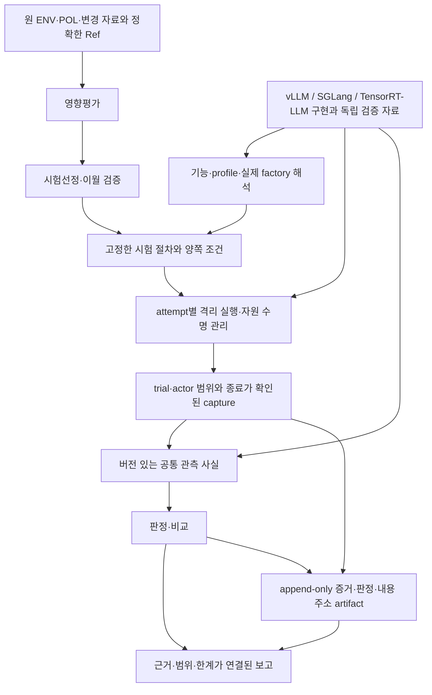

# 반복 업데이트·다중 엔진을 위한 통합 설계 검토 — 2026-11-08

기업이 엔진 업데이트마다 영향평가 → 시험선정 → 격리실험 → 보고를 반복하는 것이 제품 목표다. vLLM에서 먼저 동작한 코드를 SGLang과 TensorRT-LLM에도 확장해야 한다.

현재 구조는 이 목표에 맞춰 동결할 상태가 아니다. 앞선 D01~D12 보수에는 CPU에서 확인할 수 있는 미완성과 회귀가 남아 있다. 2차 감사 F01~F14를 포함해 검토했고, 이번에는 추가로 G01~G07을 확인했다. 항목 수를 더하는 대신 아래 아홉 경계로 통합했다. 서로 겹치는 D/F/G가 있으므로 이를 독립 결함 33개로 집계하지 않는다.

**앞으로 구조 변경이 전혀 없다는 보장은 할 수 없다.** 현실적인 목표는 지원 범위 안의 엔진·버전·백엔드·배치 구성을 추가할 때 공통 선정·실행 조율·판정·보고 코드를 수정하지 않고, 엔진별 구현과 검증 자료를 추가하도록 만드는 것이다. 이를 선언으로 동결하지 않고 실제 확장 시험으로 입증해야 한다.

이 문서는 감사 결과와 수정 제안이다. SPEC을 변경하거나 새 엔진 지원·수정 완료를 선언하지 않는다. 기능 추가와 커밋은 계속 보류했다.

## 검토 범위와 증거 수준

- 작업 트리: `/Users/doha/Desktop/Buyl/byul-dev1-k8s`, HEAD `8402ff8947e78c85e75d76c62b0bd91d88cc0512` 및 기존 미커밋 변경.
- 인벤토리와 보존 대조 대상은 1,363경로다. update 제품378, 팩80, tools178, tests554, 공용 계약29, platform API25, web62, runtime56, release1이다. 캐시·pyc·이미지는 제외했다. 모든 파일의 모든 줄을 수동 검증했다는 뜻은 아니다.
- 실제로 추적한 경로는 입력 계약·번역 → 변경 분석 → 선정/이월 → factory → managed/external 실행 → native/HTTP 수집 → EVD/RES/RPT → 반출·복원 및 platform 표시 경계다. 중단·재실행·동시 실행·정리 실패도 확인했다.
- 새 반례는 저장소 밖 파일과 EXAMPLE 실행기·가짜 transport·메모리 patch·소스 복사본에서 재현했다. 실제 GPU, Docker daemon, 엔진, 기업 자원에 접속하지 않았다. 공식 문서는 웹에서 읽었다. 엔진·모델·새 의존성은 내려받지 않았다.
- [1차 감사 D01~D12](/Users/doha/Desktop/Buyl/byul-dev1-k8s/update/docs/dev-1/design-anchor-audit-20261108.md), [보수 내역](/Users/doha/Desktop/Buyl/byul-dev1-k8s/update/docs/dev-1/design-fixes-20261108.md), [2차 감사 F01~F14](/Users/doha/Desktop/Buyl/byul-dev1-k8s/update/docs/dev-1/design-anchor-audit-2-20261108.md)의 원본과 재현 자료를 유지했다.
- 이번 [원자료 폴더](/Users/doha/.codex/visualizations/2026/11/08/01a1b99a-d7c6-79e0-8db2-4cb4b4cc71ed/architecture-final-review)에는 인벤토리, 실행 스크립트, 최초 재현의 준비 오류, 수정한 재현 입력, 로컬 Store 및 시험 로그를 함께 남겼다.

## 이번에 추가로 확인한 G01~G07

| ID | 우선 | 확인한 결함 | CPU 재현 결과 |
|---|---|---|---|
| G01 | P1 | 묶음 후반의 저장 오류가 앞선 완료 관측을 빈 중단 기록으로 가림 | 앞선 위반은 FAIL 후보였지만 같은 EVD의 revision2가 ABORTED로 추가되고 보고는 UNKNOWN |
| G02 | P1 | 같은 PLAN의 동시 실행에 attempt 식별·작업 디렉터리 격리가 없음 | 실행 A의 EVD에 실행 B의 파일 bytes가 첨부되고 두 EVD 모두 COMPLETED |
| G03 | P1 | 기준 환경 정리 실패 뒤에도 후보 환경 기동을 계속함 | baseline start → cleanup failed → candidate start 순서를 확인 |
| G04 | P1 | 독립 tokenizer 변경이 원본 보존 경고에만 남고 선정 입력에서 빠짐 | 원 외부 ENV 해시가 달라도 내부 model은 같고 model_changed=False |
| G05 | P1 | 새로 발견한 GET 경로를 안전한 요청으로 기본 취급함 | 미등록 예시 GET이 SGLang/TRT 양쪽에서 mutating 허용=False인데도 요청 후보가 됨 |
| G06 | P1 | GPU 수량 선언을 bool로 줄여 실제 장치 할당을 잃음 | gpu_count=1과4가 모두 Docker `--gpus all`, limits=None으로 계획됨 |
| G07 | P1 | 현재 manifest의 해시가 검토된 source의 허용 신원으로 자동 편입됨 | 복사본 source 수정·manifest 재생성 후 B 승인 모듈 bytes를 바꾸지 않고 새 조합의 gate 통과 |

### G01 — 부분 완료와 묶음 완료를 같은 성공 flag로 취급

[run_plan:143](/Users/doha/Desktop/Buyl/byul-dev1-k8s/update/src/guard/core/run.py:143)은 점검마다 EVD를 저장한다. [execute_validation:326](/Users/doha/Desktop/Buyl/byul-dev1-k8s/update/src/guard/application.py:326)의 completed는 전체 run_plan이 반환된 다음에만 True다. 그전에 예외가 나면 [337](/Users/doha/Desktop/Buyl/byul-dev1-k8s/update/src/guard/application.py:337)에서 abort_reason을 붙여 전체를 다시 run_plan한다. update에도 같은 패턴이 있다.

실제 Store와 run_plan을 사용해 REQ-01 완료 관측을 저장하고, 다음 REQ-03의 EVD 저장에서 일회성 오류를 주입했다. REQ-01 원 관측은 실제 판정 함수에서 FAIL이었다. 복구 분기가 REQ-01에 빈 ABORTED revision2를 추가했고 최종 보고는 UNKNOWN이었다. 원 revision1의 bytes와 Ref는 남는다. 따라서 원본 삭제가 아니라 **최신 결과 선택 때문에 독립 위반이 가려지는 문제**다. 실제 기업의 FAIL이 사라졌다는 측정은 아니다.

완료한 조각의 checkpoint와 아직 완료하지 않은 작업을 구분해야 한다. 실패한 작업의 상태를 새 기록으로 남기되 앞선 완료 조각을 전체 재실행의 빈 기록으로 대체하지 않아야 한다. 같은 attempt의 관측 보존과 사용자가 명시적으로 새 attempt를 실행하는 경우를 구분한다.

근거: `verified/probes.json → partial_batch_failure_probe`. Store.verify는 문제가 없다고 반환했다. 해시 무결성과 실행 의미의 보존은 다른 조건이다.

### G02 — PLAN이 실행 attempt를 대신함

[작업 경로:169](/Users/doha/Desktop/Buyl/byul-dev1-k8s/update/src/guard/core/run.py:169)는 `store/work/<plan>/<check>/<side>`다. EVD revision이나 attempt가 없다. existing 조회도 실제 실행보다 앞에서 일어나며 점검/side 단위 실행 잠금이 없다. [공용 run-context](/Users/doha/Desktop/Buyl/byul-dev1-k8s/contracts/schemas/run-context.schema.json:11)도 run_id를 PLAN ID로 정의한다.

같은 PLAN에 두 EXAMPLE 실행을 연결하고 로컬 thread를 동기화했다. A가 자기 파일을 쓴 뒤 B가 같은 경로를 썼다. A가 반환한 정상 draft의 첨부는 B의 bytes였다. CAS 저장을 직렬화한 후에도 두 EVD 모두 COMPLETED였고 같은 check/side의 서로 다른 EVD ID가 생겼다. Store.verify는 이 경우도 통과한다.

현재 CLI를 두 번 겹쳐 실행하는 것만으로 도달할 수 있는 구조다. 여러 고객·여러 호스트를 지원해야만 발생하는 문제가 아니다. 최소한 같은 PLAN/check/side의 동시 실행을 명시적으로 거부하거나, attempt별 작업 경로·취소·최신 결과 선택을 독립시켜야 한다. 재시도/복구는 idempotency key와 attempt generation에 결합해야 한다.

근거: `verified/probes.json → simultaneous_attempts_probe`. 최초 조율에서는 별도로 CAS의 공용 `.tmp` 경쟁으로 한쪽이 ABORTED되기도 했다. 후속 반례는 CAS 경쟁을 피한 상태에서 작업 경로 혼입만 확인했다. 두 기록을 모두 보존했다.

### G03 — cleanup 실패가 다음 실행의 전제에 반영되지 않음

[execute_update의 side loop](/Users/doha/Desktop/Buyl/byul-dev1-k8s/update/src/guard/application.py:150)는 baseline cleanup 오류를 limitations에 남긴 뒤 candidate를 계속 시작한다. fake Docker에서 `start:baseline, cleanup_failed:baseline, start:candidate`를 확인했다. 최종 실패 상태와 cleanup 경고는 올바르게 남는다. 실제 자원 유출이나 GPU 충돌을 재현한 것은 아니다.

하지만 정리에 실패한 자원이 다음 실행의 GPU·포트·마운트·네트워크 조건과 겹치는지 판단하는 계약이 없다. 후보에 독립적으로 할당된 자원이 입증되면 진행할 수 있지만, 공유 자원을 반환받았다는 근거 없이 다음 의존 작업을 시작해서는 안 된다. 별개 작업의 계속 실행과 자원 반환에 의존하는 다음 작업의 진행을 구분해야 한다.

근거: `verified/probes.json → cleanup_dependency_probe`. 기존 `test_managed_update_uses_distinct_targets_and_cleans_up`도 cleanup 오류에도 양쪽 side를 방문하는 현재 동작을 기대한다. 따라서 예외 처리 한 줄이 아니라 실행 전제와 수락 조건을 함께 정리할 항목이다.

### G04 — 모델 snapshot 하나가 전체 모델 구성의 신원을 대신함

공용 ENV는 [tokenizer_revision](/Users/doha/Desktop/Buyl/byul-dev1-k8s/contracts/schemas/environment.schema.json:47)을 허용한다. [importer:152](/Users/doha/Desktop/Buyl/byul-dev1-k8s/update/tools/import_byul_inputs.py:152)는 이를 원본/경고에만 남기고 내부 model에는 id/revision/inventory_sha256만 옮긴다. [input_diff:39](/Users/doha/Desktop/Buyl/byul-dev1-k8s/update/src/guard/core/change_selection.py:39)도 그 세 값만 본다.

공용 schema 검증을 실제 통과하는 두 외부 문서에서 tokenizer_revision만 바꿨다. 원본 해시는 달랐고 내부 모델은 같았으며 input_diff는 변경 없음이었다. 실제 오이월 PASS를 만든 시험은 아니다. 전체 마운트 inventory에 tokenizer bytes를 포함하는 구성에서는 그 inventory 차이로 변경이 잡힐 수 있다. **별도 tokenizer 신원을 선언하는 합법 입력이 직접 선정에 전달되지 않는 것**이 반례다.

F09의 HF 이름 제약보다 넓은 문제다. tokenizer·processor·template·LoRA·draft model·변환/컴파일 산출물이 별도 구성일 때 각각의 신원과 연결을 표현할 수 있어야 한다. 현재 model_manifest도 LoRA/adapter 갱신을 계약 밖이라고 명시한다. 그 범위를 임의로 완료 처리하면 안 된다.

근거: `tokenizer.json`, `tokenizer_verified.py`. 최초 누락 의존 경로/잘못 준 함수 인자는 재현 준비 오류로 보존했고 제품 결함으로 세지 않았다.

### G05 — 경로 발견과 안전한 요청 권한을 혼동

[OpenAIEngineAdapter.routes_from_openapi:44](/Users/doha/Desktop/Buyl/byul-dev1-k8s/update/src/guard/adapters/openai_engine.py:44)는 알려진 관리 경로 외에는 inference, mutating=False로 분류한다. [probe_request:63](/Users/doha/Desktop/Buyl/byul-dev1-k8s/update/src/guard/adapters/openai_engine.py:63)는 그런 GET에 요청을 만든다. [probe_templates:484](/Users/doha/Desktop/Buyl/byul-dev1-k8s/update/src/guard/executors/http_common.py:484)는 allow_mutating=False여도 그 후보를 받는다.

새 상태 변경 작업을 뜻하는 **가상의** GET 하나를 OpenAPI에 넣어 SGLang·TRT 어댑터 모두에서 확인했다. 특정 실제 엔진에 해당 endpoint가 있다는 주장이 아니며 요청도 전송하지 않았다. blacklist에 없는 미래 GET이 안전한 요청으로 기본 분류된다는 확장 계약의 반례다.

발견한 route는 영향평가/등록 목록의 근거다. 무해한 요청을 보내도 된다는 근거는 버전/기능에 맞춰 검토한 probe 계약이어야 한다. 알 수 없는 endpoint·변경된 request schema는 미검증으로 남기고 호출을 생략해야 한다. GET이라는 method만으로 무해함을 추론하지 않는다.

근거: `verified/probes.json → unknown_get_probe`.

### G06 — 자원 수량·장치 신원이 실행 bool로 축소됨

[prepare_managed:117](/Users/doha/Desktop/Buyl/byul-dev1-k8s/update/src/guard/adapters/engine_provider.py:117)은 gpu_count를 `> 0`으로 바꾼다. [LaunchPlan:351](/Users/doha/Desktop/Buyl/byul-dev1-k8s/update/src/guard/adapters/vllm.py:351)도 gpus bool이고 [Docker:205](/Users/doha/Desktop/Buyl/byul-dev1-k8s/update/src/guard/runtime/docker.py:205)는 True를 `--gpus all`로 만든다. 생성 ENV도 [358](/Users/doha/Desktop/Buyl/byul-dev1-k8s/update/src/guard/runtime/sandbox.py:358)에서 GPU 사용 여부를 수량1로 적는다.

실제 provider의 준비/launch 계획에 로컬 EXAMPLE inventory와 gpu_count=1/4를 각각 넣었다. 둘 다 device assignment 없이 `--gpus all`, container limits=None이었다. Docker 명령은 주입한 recorder로만 받았고 실행하지 않았다. CPU bounded profile의 자원 제한은 별도로 존재한다.

GPU 개수·UUID/MIG·프로세스 할당·TP 배치를 명시적인 resource request와 관측한 allocation으로 나눠야 한다. 지원하지 않는 할당은 실행 전에 거부한다. 전용 호스트 전체 GPU 사용도 명시적인 지원 모드로 표현해야 하며 선언1을 묵시적으로 all로 해석하지 않는다. F04의 worker topology와 G03의 자원 반환 전제에 연결된다.

근거: `gpu-allocation.json`, `gpu_allocation_probe.py`.

### G07 — 현재 내용의 해시와 독립된 검토 신원이 분리되지 않음

[B helper:41](/Users/doha/Desktop/Buyl/byul-dev1-k8s/update/tools/b_lif07_native_capture.py:41)는 현재 reviewed-source.json의 bytes 해시를 계산해 HTTP 허용 목록과 APPROVED_GATE_PROFILES에 넣는다. [verifier](/Users/doha/Desktop/Buyl/byul-dev1-k8s/update/tools/verify_req10_consumption.py:25)도 같은 현재 파일의 해시를 기대값으로 읽는다. 이력에 고정된 기존 조합들과 달리 manifest 조합은 파일 재생성만으로 허용 신원이 바뀐다.

제품과 B helper의 복사본을 만들고, common source에 예시 주석 한 줄만 추가했다. 제공되는 write_manifest로 목록을 재생성하고 새 프로세스에서 검증했다. manifest SHA는 `3223cac5…`에서 `c071cd5a…`로 달라졌는데 B 승인 모듈 bytes를 바꾸지 않고 새 SHA가 허용 목록에 들어가 실제 helper.verify_source가489파일 검증을 통과했다. 출력의 runtime_hash_approval은 False였다.

이 반례는 컴퓨터를 장악한 공격자나 실제 MEASURED 승격을 보여 주는 것이 아니다. **수집한 현재 source inventory와 그 inventory를 검토한 release의 신원 사이에 독립적인 승인 연결이 없다**는 점을 보여 준다. manifest 생성과 검토/수락은 서로 다른 단계여야 한다. 새 전자서명 서비스까지 도입할 필요는 없다. 배포와 함께 고정한 독립 receipt/허용 manifest digest를 사용하고, 검토하지 않은 새 manifest는 구현 준비 상태로만 표시할 수 있다.

원본 작업 트리나 생산 승인 목록은 수정하지 않았다. 이 복사본의 gate 통과를 승인으로 사용해서는 안 된다. F01은 자기 해시 안의 literal 때문에 등록을 완료할 수 없는 문제이고, G07은 관측값이 허용 신원에 자동 편입되는 반대 방향의 문제다. 둘 다 release bytes와 qualification receipt를 분리해야 해결된다.

근거: `manifest-review-complete.json`, `manifest_review_probe_complete.py`. 최초 복사본에 tests.builders가 없어 난 import 실패는 준비 오류로 별도 보존했다.

## 기존 항목까지 통합한 아홉 설계 경계

| 경계 | 포함하는 근거 | 최종 구조에서 고정할 책임 |
|---|---|---|
| R1 엔진·백엔드·전송·기능 선택 | D02/D03/D04/D06, F06, runtime_kind의 TRT 미지원 | 엔진별 profile/실제 factory를 한 resolver로 선택. core는 vendor·버전·내부 함수명을 모름 |
| R2 actor·topology·인과 | D01, F03/F04, G06 | worker/rank/group/프로세스 세대와 실제 기동 scope를 보존. rank 번호만으로 coverage를 계산하지 않음 |
| R3 release·qualification·출처 | D05/D12, F01/F14, G07 | 코드/의미/wire 신원과 독립 receipt. lab 소유권·합성 여부·관측/검증 수준을 분리 |
| R4 trial·비교·이월 | D08, F02/F07/F10 | 같은 immutable 절차에서 실행/preview/양쪽 조건을 생성. 실행 binding과 비교 의미를 분리 |
| R5 기업 입력·정책·모델 구성 | D09, F08/F09/F13, G04 | 원 문서 Ref·digest·locator·기간·구성요소 신원을 번역하며 잃지 않음 |
| R6 attempt·실패·복구·자원 반환 | G01/G02/G03/G06 | 부분 완료 checkpoint, 별도 attempt, 자원 소유/할당/반환 전제, 재개와 새 실행의 구분 |
| R7 capture의 수명과 완결성 | D11, F05/F11 | trial epoch, producer별 watermark, 유실/flush ACK, trial 간 cursor를 가진 capture |
| R8 설치·계약 진화·보존·수락 | D07/D10, F12, 전체 회귀 기록 | 설치본 실제 경로, 버전별 codec/migration, 기존 bytes/Ref와 동적 시험 목록의 수락 |
| R9 안전한 probe 실행 | G05 및 기존 native safe-probe 계약 | route 발견과 요청 허용을 분리. 미검증 endpoint/형식은 호출하지 않음 |

앵커링을 전부 제거하자는 뜻은 아니다. 기존 증거 reader와 qualification에 고정된 source/image/schema/hash는 필요한 재현 경계다. 없애야 하는 것은 그 경계를 통하지 않고 **새 실행의 공통 경로가 특정 엔진/버전/단일 worker/개발 checkout을 가정하는 것**이다. 해시 검사를 느슨하게 해 확장하지 않는다.

## 세 엔진을 대입했을 때 드러나는 제약

vLLM 공식 구조는 API process, scheduler/KV를 다루는 EngineCore, model executor의 GPU worker를 구분한다. 현재 센서의 vLLM 내부 함수 신원은 그 구현용으로 유지할 수 있지만, 그 함수 호출 순서를 공통 사실의 정의로 사용하면 다른 엔진에 같은 구조를 강제하게 된다. [vLLM Architecture Overview](https://docs.vllm.ai/en/latest/design/arch_overview/)

SGLang은 prefill/decode를 분리하고, multimodal에서는 encoder도 별도 서버로 나누는 구성을 문서화한다. 따라서 하나의 Pod, 한 TP group, 하나의 rank0, 한 request ID 수명을 공통 전제로 삼으면 단순한 센서 포팅 이후에도 재설계가 필요하다. actor와 실행 stage의 관계를 표현하는 계약이 먼저 필요하다는 판단이다. 모든 분산 모드를 당장 구현하라는 뜻은 아니다. 초기 미지원 구성도 정확히 식별해 거부할 수 있어야 한다. [SGLang PD](https://docs.sglang.io/docs/advanced_features/pd_disaggregation), [SGLang EPD](https://docs.sglang.io/docs/advanced_features/epd_disaggregation)

TensorRT-LLM 공식 `latest` migration 문서는 TensorRT engine backend 제거와 PyTorch 전환을 명시한다. 이는 특정 배포 릴리스의 지원 선언이 아니며 이번에 실제 실행한 것도 아니다. 엔진 브랜드를 compiled engine 형식이나 하나의 실행 backend와 동일시하면 안 된다는 실제 upstream 변경 사례다. [TensorRT-LLM migration](https://nvidia.github.io/TensorRT-LLM/latest/legacy/tensorrt-backend-removal.html)

TensorRT-LLM checkpoint loading도 HF 및 사용자 정의 loader/config/weight mapping을 별도 구성으로 설명한다. 공통 모델 입력을 HF org/name + Git revision 한 쌍으로 고정할 근거가 없다. 공급물 신원/역할은 공통 계약으로, 구체적 형식 검증은 artifact provider로 넘기는 방향이 적합하다. [TensorRT-LLM checkpoint loading](https://nvidia.github.io/TensorRT-LLM/latest/features/checkpoint-loading.html)

SGLang/TRT의 현재 HTTP 어댑터 등록은 managed launch, native 센서, 공용 runtime 지원, 전체 점검의 qualification을 뜻하지 않는다. 이 상태를 이유로 SGLang을 포기할 필요는 없다. 현재 설계의 가정을 vLLM 전용으로 묶어 영구화하면 제품 목표가 축소된다.

## 동결 전에 정할 계약

아래 이름은 제안한 책임의 구분이며 현재 구현된 새 객체 이름이 아니다. 새 microservice·범용 workflow 언어·전자서명 registry·DB 교체를 요구하지 않는다. 기존 append-only Store와 내용 주소 artifact 위에서도 시작할 수 있다.

### 1. 엔진 실행 설명과 기능 해석

engine ID, 실제 source/image 신원, implementation backend, CPU/CUDA 등 device backend, 프로세스 배치/전송, 모델 artifact 형식, 관측 방식은 별개의 값이어야 한다. backend를 engine 브랜드나 CPU/GPU 둘 중 하나로 모두 표현하지 않는다.

resolver는 check가 요구하는 **의미 있는 기능**을 입력받고 profile ref, 실제 factory, fixture/normalizer 계약, 지원 topology, 미지원 사유를 반환한다. 준비 검사와 실행 factory가 같은 결과를 소비해야 한다. 현재처럼 catalog 추가 후 다른 wrapper가0.31에서 거부하거나, 모르는 native profile이 generic HTTP feature로 fallback하는 구조는 수락하지 않는다.

지원 구현 있음, source 검토됨, runtime qualification 있음, 이번 실행이 ready임, 관측을 수집함, 전체 scope가 complete임, 버전끼리 comparable임은 서로 다른 상태다. metadata 등록을 runtime 증명으로 승격하지 않는다.

### 2. 선정부터 실행까지 유지하는 immutable 시험 절차

PLAN의 입력/선정 결과와 실제 실행의 연결을 고정할 절차 artifact가 필요하다. pack/check definition의 정확한 신원, 원 ENV/POL와 내부 번역의 연결, 양쪽 effective 설정, fixture/선정 trial, 필요한 capability, 비교 profile, 실행 권한과 resource request를 식별해야 한다.

실행, reuse preview, fixture hash, comparison hash를 같은 해석 결과에서 생성한다. 새로운 nonce/주소/자원 이름 등 실행 binding은 따로 보존한다. 비교에서 제외할 변동값은 절차가 사전에 정의한 항목이어야 하며, 해시를 맞추기 위해 임의 입력 차이를 지우지 않는다. baseline/candidate의 의미 있는 설정 차이는 양쪽에서 검사한다.

기존 PLAN은 당시 의미로 읽는다. optional 필드나 새 계약을 도입할 때 기존 객체의 직렬화·content_sha256이 달라지지 않게 versioned reader/migration을 설계한다.

### 3. 모델 구성의 신원

최소한 역할, artifact-kind/provider, 불변 digest, locator, 원본/파생 관계를 갖는 구성 목록이 필요하다. weights, tokenizer, processor, template, adapter, draft model, 빌드 산출물을 같은 역할로 뭉치지 않는다. compiled artifact는 해당 엔진 버전에 필요할 때만 build 입력·설정·도구·대상 하드웨어의 관계를 기록한다.

공통 코드는 HF URL/Git revision 규칙을 강제하지 않는다. 기존 HF 검증은 HF provider에서 유지한다. 입력에 별도 구성 신원이 있는데 이를 실행/선정에 반영할 수 없으면 명시적으로 unsupported로 처리한다. 원본에 경고만 남기고 반복 실행 입력에서 사라지게 하지 않는다.

### 4. 관측의 actor와 의미

관측에는 attempt/trial, 원 이벤트 ID, producer release와 의미/schema version, 관측한 actor 세대와 배치 group, request/attempt의 연결, sequence/parent 인과, clock domain을 식별할 수 있어야 한다. PID와 rank는 단독 전역 ID가 아니다. rank=None은 관측 불확실성이지 rank0이 아니다.

다중 노드의 monotonic timestamp를 그대로 비교하지 않는다. actor-local 순서와 메시지 연결을 사용하고, 시계 간 비교가 필요한 경우 검증한 mapping/오차 범위를 요구한다. 기대 actor 목록은 실제 bootstrap/배치 관측과 결합한다. 사용자 배열 길이만으로 누락 없는 scope를 증명하지 않는다.

엔진별 hook 이름/함수 순서는 adapter의 provenance다. judge에 제공하는 사실의 의미와 범위를 versioned normalizer 계약으로 정해야 한다. 어느 엔진에서 필요한 의미를 증명할 hook이 없으면 해당 사실은 미수집이다. 유사한 함수 이름을 같은 증거로 간주하지 않는다.

### 5. capture와 유실 상태

trial 시작/종료 epoch, actor별 수신·기록 watermark, flush/close ACK, 유실/오류, 해당 범위의 raw page refs와 continuation을 함께 고정해야 한다. 파일 prefix EOF만으로 trial 종료를 주장하지 않는다.

전체 세션 cap을 높여 해결하지 않는다. 해당 trial의 원 범위를 먼저 정하고 그 범위에 projection budget을 적용한다. 이후 trial은 이전 행에 밀리지 않아야 한다. 한 producer의 유실/late page/변경이 있으면 그 scope의 complete만 무효화하고 원 행과 독립 위반은 보존한다.

### 6. release와 qualification

producer 실행 bytes, wire schema, 의미 profile, normalizer 의존성은 release 신원에 포함한다. qualification은 그 신원 바깥의 독립된 artifact로 유지한다. 현재 해시를 다시 계산해 허용 목록에 넣는 행위를 qualification으로 해석하지 않는다. 새 항목을 등록할 때 자기 해시가 바뀌는 순환도 없어야 한다.

receipt에는 실제 검증한 image/source/backend/topology/관측 모드와 증명한 claim의 범위가 필요하다. Python 코드 신원에 의존하는 관측기는 Python/컴파일러/ABI/OS/architecture도 해당 신원에 포함해야 한다. 제어 도구가 실행되는 호스트와 관측 대상 엔진의 런타임을 구분한다. 계측 오버헤드도 검증 범위에 포함한다. EXAMPLE fixture, CPU source component, 실제 GPU 관측을 구분한다. lab 소유권·격리/변경 권한과 synthetic 자료 등급을 별도로 기록하고 기존 EXAMPLE을 소급 승격하지 않는다.

**버전마다 확인과 qualification 판단은 필요하다. 센서 코드를 매번 새로 작성해야 한다는 뜻은 아니다.** hook/정규화 의미가 같다는 검증 자료가 있으면 구현/profile을 공유할 수 있다. 버전 문자열만 바뀌었다고 새 release를 자동 허용하거나, source bytes가 같다는 이유만으로 backend/topology/호출 의미까지 같다고 간주하지 않는다.

### 7. 실행 attempt와 복구

선정 PLAN, 논리적 실행 요청, 물리적 attempt, 개별 trial을 구별한다. attempt별 디렉터리와 artifact staging을 사용하고 같은 idempotency key의 중복 실행을 제어한다. 같은 내용의 CAS 동시 쓰기도 안전하게 처리해야 한다.

실행 전 자원 소유/할당을 확인하고, 실제 생성 자원을 기록하며, 정리 결과에 따라 다음 의존 작업을 허용한다. crash 후 재개에서는 이미 완료한 조각을 재사용할지 새 attempt로 실행할지 명시한다. try/finally만으로 프로세스 강제 종료 후 정리가 보장되지는 않는다. 소유가 확인되지 않은 자원은 복구 명목으로 삭제하지 않는다.

부분 저장 실패는 원 관측/독립 FAIL을 없애거나 최신 빈 기록으로 가리지 않아야 한다. 새 attempt의 미완료와 과거 attempt의 FAIL을 보고에서 각각 설명할 수 있어야 한다.

### 8. 안전한 probe와 기업 입력의 효력

route 발견은 수집 사실이고, 요청 실행은 검토된 probe와 권한에 의존한다. method·경로·request/response schema·부수효과·허용 scope를 검토한다. 관리 경로 blacklist에 없다는 이유로 요청하지 않는다.

원 정책의 유효 기간/폐기/실행 시점 효력과 원 ENV의 대상 신원을 신규 실행 시 검증한다. 과거 증거 재판정의 as-of는 신규 실행 시점의 효력 확인을 대신하지 않는다. 정책 문서 해시와 실제 runtime-policy bytes 해시는 각각의 신원을 유지하고 번역/배포 manifest로 연결한다. 서로 다른 해시 공간을 직접 동등 비교하지 않는다.

## 수정 순서와 완료 관문

| 순서 | 작업 묶음 | GPU 없이 끝낼 수 있는 수락 조건 |
|---|---|---|
| 1 | R2/R3: F01/F03/F04/G07 | 독립 receipt 등록·재로딩, rank 불확실성의 부분 gap 처리, 같은 rank의 별도 집단 구분, 미검토 새 manifest의 자동 허용 금지 |
| 2 | R6: G01/G02/G03/G06 | 부분 저장 후 FAIL 보존, 중복 실행 거부 또는 attempt 격리, CAS 동시 쓰기, 자원 할당·반환 전제의 가짜 backend 실패 시험 |
| 3 | R1/R4: F02/F06/F07/F10 | resolver가 실제 factory까지 도달, 실행/preview 단일 절차, 양쪽 설정 검증, native 비교 필드/의미 연결 |
| 4 | R5/R9: F08/F09/F13/F14/G04/G05 | 공용 원문→내부 번역→계획→가짜 실행→보고 전체 통과, tokenizer 등 구성 변경 선정, 기간 검증, 미검증 route 전송 없음 |
| 5 | R7: F05/F11 | drop/늦은 상태 게시/close 없는 prefix/프로세스 재시작 시험, 같은 session 반복 trial의 cursor와 행 범위 확인 |
| 6 | R8: D07/D10/F12 및 실제 세 엔진 확장 시험 | 설치본 재판정/복원, migration 재적용의 no-op 또는 사전 거부, 확장 시 공통 수정이 없는 계약 시험, 기존 전체 회귀 해결 |

CPU 관문 통과는 GPU/native qualification을 대신하지 않는다. 다음 관문까지 만족하기 전에는 전체 설계가 고정됐다고 선언하지 않는다.

1. **공통 코드 수정 없는 엔진 확장.** 별도 테스트용 새 engine ID와 profile을 등록해 영향평가→선정→실행→관측 정규화→판정→보고의 실제 factory 경로를 실행한다. static Protocol/catalog 자체 대조만으로 통과하지 않는다. 모든 자료는 EXAMPLE로 유지한다.
2. **세 실제 엔진의 서로 다른 구조를 계약에 대입.** SGLang·TensorRT-LLM의 선택한 실제 source/profile을 검토하고 backend/actor/artifact 차이를 표현한다. 이후 승인된 자원에서 엔진별 작은 실제 경로를 검증해야 한다. 그 과정에서 공통 core를 고쳐야 하면 동결을 보류한다. 이름만 다른 mock 세 개는 이 관문을 대신하지 않는다.
3. **연속 업데이트.** 첫 버전→다음 버전, 그 다음 버전, patch, 모델/입력/정책 변경을 연속 실행한다. 0.31/0.32/0.33은 사용자의 시나리오이며 미검증 버전의 지원 선언이 아니다. unknown source/ABI/backend는 명시적인 unsupported 또는 UNKNOWN으로 끝나야 한다.
4. **topology.** TP1/TP2, 같은 rank 번호의 여러 group, PP/DP/replica, prefill/decode 분리, actor 재시작, 모르는 rank와 서로 다른 clock domain을 입력한다. 구현하지 않은 topology는 사전 거부한다. 일부 집단을 삭제해도 complete가 유지되는 반례가 없어야 한다.
5. **capture 반복.** 전체 세션이4096행을 넘어도 각 trial 범위가 바르게 선택되는지, 유실/변경/late page가 scope별 gap으로 남는지 확인한다. raw page 보존과 독립 FAIL이 유지돼야 한다.
6. **실패·동시 실행.** 첫 EVD 저장 뒤 다음 저장 실패, 같은 PLAN의 동시 실행, 동일 CAS bytes의 경쟁, 중단 후 재개, cleanup 실패와 자원 반환 미확인에서 증거 혼입과 위반 은폐가 없어야 한다.
7. **입력 정보 보존.** runtime_kind, digest/locator, tokenizer/processor/adapter 신원, 정책 기간, baseline/candidate 설정 중 하나씩 바꾸며 선정/거부/비교 이유를 확인한다. 원 문서를 편집해 importer를 통과시키는 우회는 수락하지 않는다.
8. **기존 증거 재현.** 원 evidence/result/팩/source pin과 등록8종을 보존한다. 예전 reader를 새 의미로 바꾸지 않는다. 과거 객체 해시, 명시 빈 값과 미입력, UNKNOWN/NOT_COMPARABLE/독립 FAIL, 저장소 반출·복원을 검증한다. 이전 설치 시험의 wheel만 통과했다는 사실로 현재 확장을 완료 처리하지 않는다.
9. **지원 행렬.** 엔진 전체에 단일 supported bool을 붙이지 않는다. check/feature×버전/source×backend×topology×실행/관측 모드별 구현/qualification/한계를 보고한다. 77개 중 일부 HTTP가 동작했다고 엔진 전체 지원으로 집계하지 않는다.

실제 동작 기준으로 동결할 최소 공통 흐름은 다음과 같다. 엔진별 내부 함수와 파일 형식은 맨 아래 구현이 소유한다.

## 시험 기록·보존

전체 기본 시험은 **10,767 passed / 814 failed / 92 errors / 1 skipped / 19 deselected**, pytest504.89초, 부모505.753초였다. 명령은 `uv run python -m pytest -q -p no:cacheprovider --basetemp=<저장소 밖 경로>`다. 기본 engine/docker/network 제외 표식은 유지했고, 실행을 시간 제한으로 중단하지 않았다. 기존 시험·assert·기대값·skip을 변경하지 않았다. `regression.log/json`에 원 결과를 보존했다.

이 실패906건을 새로운 독립 설계 결함906개나 전부 이번 변경의 회귀로 해석하면 안 된다. 호스트는 Darwin arm64, CPython3.12.13이다. 진단 문구 기준으로817건은 CODE/RUNTIME_UNAVAILABLE·RUNTIME_UNSUPPORTED 계열이고4건은 Linux renameat2 부재가 나타난다. 예를 들어 attempt 관측기의 등록 런타임은3.12.3/3.12.14/3.12.15이며 이번3.12.13은 없다. 거부를 풀거나 해시를 바꿔 해결할 대상이 아니다. 이 분류는 각 실패의 유일 원인을 확정한 분석은 아니다.

나머지85건에는 개별 원인 확인이 필요하다. 일부도 Linux /proc나 미등록 Python 런타임에 의존하며, 실제 소비 연결·고정 source binding·변경된 호출 계약도 포함한다. 예를 들어 worker readiness HTTP의 B 기대 startup binding SHA는 `a63c8162…`인데 현재 파일은 `22faccf2…`다. 실제 validator가 이 값을 대조하므로 기대 pin을 임의 갱신해 시험을 통과시켜서는 안 된다. 기존 reader와 새 release의 선택을 나눠야 한다. managed update의 기존 호출 fixture와 새 engine_options 호출 사이의 호환 실패도 확인된다. 모든85건을 새 결함으로 집계하지 않았다. `regression-triage.json`에 시험별 진단과 분류를 남겼다.

앞선 일부 시험1,185개 또는204개 통과는 해당 범위의 결과로만 유지한다. 전체 제품의 통과를 뜻하지 않는다. 현재 전체 기본 시험이 통과하지 않았으므로 수정/출하 완료 및 세 엔진 확장 완료로 판단할 수 없다.

시작 snapshot의1,363경로를 다시 해시 대조해 변경0·누락0을 확인했다. HEAD도 그대로다. 이번 저장소 변경은 이 감사 문서와 PROGRESS 기록이며, 이전 미커밋 구현·원 증거·판정·source pin·루트 AGENTS.md 삭제 상태를 유지했다. 커밋·push는 하지 않았다.

새 반례 중 producer/qualification의 가상 승인, 가상 route, EXAMPLE 실행기, 일회성 저장 오류, copy-only manifest는 해당 재현 범위 안에서만 사용했다. 생산 등록이나 실제 엔진 지원으로 사용하지 않는다. 제품 소스·팩·tools·tests·공용 계약·runtime·platform과 기존 증거·판정은 이번 검토에서 수정하지 않았다.
